<picture>
  <source media="(prefers-color-scheme: dark)" srcset="./dark.svg" />
  <source media="(prefers-color-scheme: light)" srcset="./light.svg" />
  
</picture>

 

  React Native developer focused on Expo, TypeScript, and clean cross-platform mobile apps. 
  Comfortable across React frontends and Node.js / NestJS backends.

---

### About

I build mobile-first products with a strong TypeScript foundation — from Expo client apps to Express and NestJS APIs.

| Area | Skills |
| --- | --- |
| Mobile | React Native, Expo, TypeScript |
| Frontend | React, JavaScript, TypeScript |
| Backend | Node.js, Express.js, NestJS |

---

### Selected Projects

- **[Shop](https://github.com/Abdelrahman-Dev9/full-stack-e-commerce-app)** — Full-stack e-commerce mobile app (Expo + Express + Prisma / Neon)
- **[Healr](https://github.com/Abdelrahman-Dev9/expo-healr-app)** — Mobile app for booking medical appointments
- **[Sanay3y](https://github.com/Abdelrahman-Dev9/expo-sanay3y-app)** — Local services marketplace ([API](https://github.com/Abdelrahman-Dev9/nestjs-sanay3y-app))
- **[Portfolio](https://github.com/Abdelrahman-Dev9/Abdelrahman-Elnagar-Portfolio)** — Personal site · [Live](https://my-portfolio-olive-theta-35.vercel.app/)

---

### Education

**Bachelor of Science — Computer Science & Informatics**  
Suez Canal University — Faculty of Computers and Informatics (2021–2025)

---

### Activity

  
  

<h2 align="center">GitHub Contributions</h2>

  <picture>
    <source
      media="(prefers-color-scheme: dark)"
      srcset="https://raw.githubusercontent.com/Abdelrahman-Dev9/github-snake/output/github-snake-dark.svg"
    />
    <source
      media="(prefers-color-scheme: light)"
      srcset="https://raw.githubusercontent.com/Abdelrahman-Dev9/github-snake/output/github-snake.svg"
    />
    
  </picture>

---

  <a href="https://github.com/Abdelrahman-Dev9">GitHub</a>
  ·
  <a href="https://www.linkedin.com/in/abdelrahman-elnagar-ab602b291/">LinkedIn</a>
  ·
  <a href="https://my-portfolio-olive-theta-35.vercel.app/">Portfolio</a>

